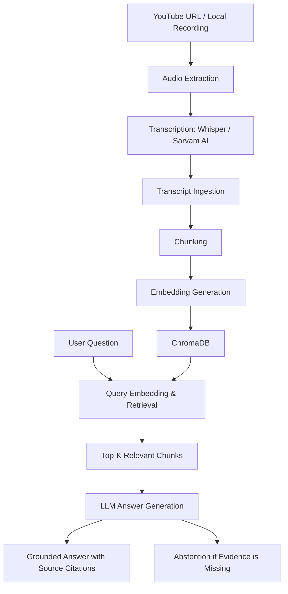

# VideoAgent 🎥

**A transcript-based Retrieval-Augmented Generation (RAG) system for meeting recordings and YouTube videos.**

An AI-powered video and meeting assistant that transforms recordings into searchable, interactive knowledge.

VideoAgent processes YouTube videos and local audio/video meeting recordings, extracts and transcribes their audio, and enables users to ask questions about the content through a Retrieval-Augmented Generation (RAG) pipeline.

Whether you're reviewing a meeting recording or learning from a technical YouTube video, VideoAgent helps you understand, organize, and retrieve important information without having to revisit the entire recording.

It supports two use cases:
- **Meeting Intelligence:** Generate summaries, action items, key decisions, and open questions from meeting recordings.
- **YouTube Video Understanding:** Ask questions about educational and technical videos without revisiting the entire recording.

## How It Works



## RAG Pipeline

| Stage | Implementation |
|---|---|
| Ingestion | Extract audio and transcribe using Whisper or Sarvam AI |
| Chunking | RecursiveCharacterTextSplitter |
| Chunk size | 500 characters |
| Chunk overlap | 50 characters |
| Embeddings | `sentence-transformers/all-MiniLM-L6-v2` |
| Vector database | ChromaDB |
| Search | Semantic similarity search |
| Retrieval | Top 4 chunks |
| Generation | GPT-OSS-120B via Groq |

### Chunking Strategy

Transcripts are divided into 500-character chunks with a 50-character overlap.

The overlap preserves context across chunk boundaries, helping avoid losing information when an explanation spans multiple chunks.

Each chunk stores metadata, including its chunk index and starting character position, allowing retrieved content to be traced back to the original transcript.

### Retrieval and Ranking

When a question is submitted:
1. The question is embedded using the same embedding model.
2. ChromaDB retrieves the four most semantically similar transcript chunks.
3. Retrieved chunks are passed to the language model as context.
4. The model generates an answer using the retrieved evidence.

The current implementation uses similarity-based retrieval rather than a separate reranking model.

### Grounded Answers and Missing Evidence

The generation prompt instructs the model to:
- Answer only using the retrieved transcript context.
- Cite supporting chunk numbers.
- Avoid assumptions and external knowledge.
- Abstain when the retrieved context does not contain sufficient evidence.

When evidence is insufficient, the assistant responds:

> I could not find this information in the meeting transcript.

## Evaluation

A manually curated dataset of seven questions is used to evaluate retrieval and answer generation. It includes both answerable and unanswerable questions.

### Initial Results

| Metric | Result |
|---|---:|
| Precision@4 | 0.550 |
| Recall@4 | 1.000 |
| MRR | 1.000 |
| Average keyword coverage | 0.867 |
| Abstention accuracy | 1.000 |

**Evaluation observations:**
- All labelled relevant chunks were retrieved within the top four results.
- The first retrieved chunk was relevant for every answerable question.
- The assistant correctly abstained on both unanswerable questions.

*These are initial results from a small evaluation dataset. Keyword coverage is a string-matching heuristic, not a direct measure of factual correctness.*

Evaluation code and test questions are available in the `evaluation/` directory.

## Sample Data

VideoAgent supports end-to-end processing of YouTube videos as well as local audio/video recordings.

A sample YouTube video is used to demonstrate the complete workflow:

**YouTube URL → Audio Extraction → Transcription → Chunking → Embeddings → Retrieval → Grounded Answers**

- **Sample Video:** https://youtu.be/VSFuqMh4hus?si=PNffNd5Q9kcrWKx5
- **Audio Extraction:** Uses `yt-dlp` to extract audio from the provided YouTube URL.
- **Transcription:** Uses Whisper for English transcription or Sarvam AI for Hinglish.
- **Evaluation Questions:** Available in `evaluation/test_questions.json`.

The sample video demonstrates the complete ingestion pipeline, while the evaluation dataset provides predefined questions for testing retrieval and answer generation.

## Tech Stack

- **Language:** Python
- **Transcription:** OpenAI Whisper, Sarvam AI
- **LLM:** GPT-OSS-120B via Groq
- **Framework:** LangChain
- **Embeddings:** Hugging Face Sentence Transformers
- **Vector Database:** ChromaDB

## Project Structure

```text
VideoAgent/
├── core/
│   ├── transcriber.py
│   ├── summarize.py
│   ├── extractor.py
│   ├── vector_store.py
│   └── rag_engine.py
├── utils/
│   └── audio_processor.py
├── evaluation/
│   ├── evaluate.py
│   └── test_questions.json
├── vector_db/
├── main.py
├── test_retrieval.py
└── requirements.txt
```

## Getting Started

### 1. Clone the repository

```bash
git clone https://github.com/saniashinde28/VideoAgent.git
cd VideoAgent
```

### 2. Create and activate a virtual environment

```bash
python -m venv .venv
.venv\Scripts\activate
```

### 3. Install dependencies

```bash
pip install -r requirements.txt
```

Make sure FFmpeg is installed and accessible through your system PATH.

### 4. Configure API keys

Create a `.env` file in the project root:

```env
GROQ_API_KEY=your_groq_api_key
```

Configure the Sarvam AI API key using the environment variable expected by your transcription implementation if using Hinglish transcription.

### 5. Run the application

```bash
python main.py
```

Enter a YouTube URL or local recording path and select the transcription language.

VideoAgent will:
1. Extract and process the audio.
2. Generate the transcript.
3. Generate a title and summary.
4. Extract action items, key decisions, and open questions.
5. Build the ChromaDB vector store.
6. Allow questions about the processed content through the RAG interface.

### 6. Run evaluation

After processing a recording and creating the vector database:

```bash
python -m evaluation.evaluate
```

The evaluation script tests retrieval quality and answer generation using the predefined evaluation dataset.

## Future Improvements

- Experiment with MMR and alternative retrieval strategies.
- Expand the evaluation dataset with manually verified relevance labels.
- Add support for multiple independent transcript collections.
- Explore timestamp-based source references for video navigation.

---

**VideoAgent — Turning recordings into searchable, evidence-grounded knowledge.**